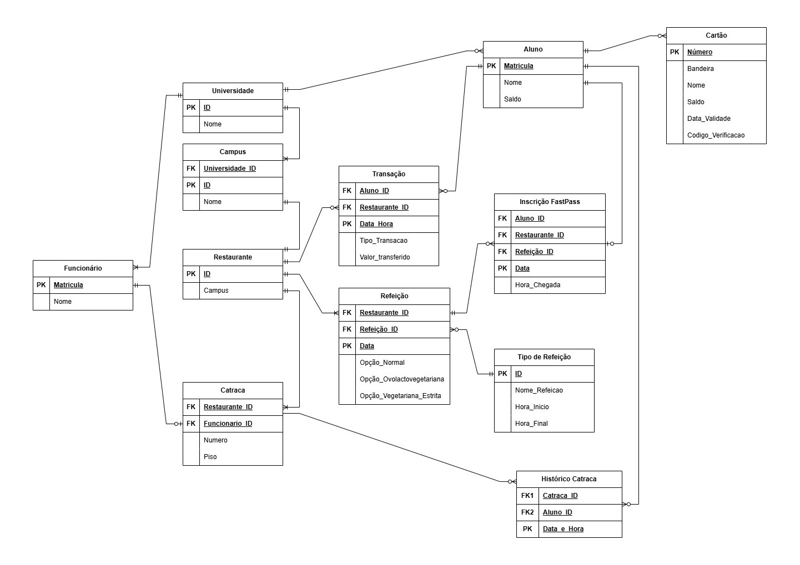

# Modelo Entidade-Relacionamento da Aplicação UnB-RU

## Introdução

A aplicação UnB-RU é um sistema desenvolvido em Ruby on Rails para o gerenciamento do
Restaurante Universitário da Universidade de Brasília. O sistema permite controlar
alunos, campi, restaurantes, refeições, cartões, transações financeiras e o acesso
às catracas. Este documento descreve as entidades representadas no modelo
entidade-relacionamento e seus principais relacionamentos.



## Entidades principais

### 1. Universidade

- **ID**: Identificador único da universidade (chave primária).
- **Nome**: Nome da universidade.

**Relacionamento:** Uma universidade pode possuir um ou vários campi. Cada campus
deve estar associado a uma universidade.

### 2. Campus

- **Universidade ID**: Chave estrangeira associada à universidade.
- **ID**: Identificador único do campus (chave primária).
- **Nome**: Nome do campus.

**Relacionamento:** Cada campus pertence a uma universidade. Um campus pode
possuir um e somente um restaurante.

### 3. Restaurante

- **ID**: Identificador único do restaurante (chave primária).
- **Campus**: Chave estrangeira associada ao campus onde o restaurante está
  localizado.

**Relacionamentos:** Cada restaurante pertence a um campus, está associado a
uma ou várias catracas e pode oferecer uma ou várias refeições. Um restaurante
também pode estar associado a nenhuma ou várias transações e inscrições
FastPass.

### 4. Aluno

- **Matrícula**: Identificador único do aluno (chave primária).
- **Nome**: Nome completo do aluno.
- **Saldo**: Saldo financeiro disponível para utilização no restaurante.

**Relacionamentos:** Um aluno pode possuir nenhum ou vários cartões, realizar
nenhuma ou várias transações, fazer nenhuma ou várias inscrições FastPass e
possuir nenhum ou vários registros de acesso no histórico das catracas.

### 5. Funcionário

- **Matrícula**: Identificador único do funcionário (chave primária).
- **Nome**: Nome completo do funcionário.

**Relacionamento:** Um funcionário pode estar associado a nenhuma ou várias
catracas. Cada catraca deve estar associada a um funcionário.

### 6. Cartão

- **Número**: Número identificador do cartão (chave primária).
- **Bandeira**: Bandeira ou operadora do cartão.
- **Nome**: Nome do titular do cartão.
- **Saldo**: Saldo disponível no cartão.
- **Data de validade**: Data até a qual o cartão é válido.
- **Código de verificação**: Código de segurança do cartão.

**Relacionamento:** Um aluno pode possuir nenhum ou vários cartões. Cada cartão
deve estar associado a um aluno.

### 7. Catraca

- **Restaurante ID**: Chave estrangeira associada ao restaurante.
- **Funcionário ID**: Chave estrangeira associada ao funcionário.
- **Número**: Número identificador da catraca.
- **Piso**: Piso onde a catraca está instalada.

**Relacionamentos:** Cada catraca pertence a um restaurante e está associada a
um funcionário. Uma catraca pode possuir nenhum ou vários registros no
histórico de acessos.

### 8. Tipo de Refeição

- **ID**: Identificador único do tipo de refeição (chave primária).
- **Nome da refeição**: Nome do tipo de refeição, como café da manhã, almoço ou
  jantar.
- **Hora de início**: Horário inicial em que o tipo de refeição é servido.
- **Hora final**: Horário final em que o tipo de refeição é servido.

**Relacionamento:** Um tipo de refeição pode estar associado a várias refeições.
Cada refeição deve possuir um tipo de refeição.

### 9. Refeição

- **Restaurante ID**: Chave estrangeira associada ao restaurante.
- **Refeição ID**: Identificador da refeição (chave estrangeira associada ao
  tipo de refeição).
- **Data**: Data em que a refeição será servida.
- **Opção normal**: Indica a opção normal do cardápio.
- **Opção ovolactovegetariana**: Indica a opção ovolactovegetariana do
  cardápio.
- **Opção vegetariana estrita**: Indica a opção vegetariana estrita do
  cardápio.

**Relacionamentos:** Cada refeição pertence a um restaurante e a um tipo de
refeição. Um restaurante pode oferecer várias refeições. Uma refeição pode
estar associada a nenhuma ou várias inscrições FastPass e transações.

### 10. Transação

- **Aluno ID**: Chave estrangeira associada ao aluno.
- **Restaurante ID**: Chave estrangeira associada ao restaurante.
- **Data e hora**: Data e hora em que a transação ocorreu (chave primária).
- **Tipo de transação**: Tipo da operação financeira realizada.
- **Valor transferido**: Valor movimentado na transação.

**Relacionamento:** Cada transação deve estar associada a um aluno e a um
restaurante. Um aluno e um restaurante podem participar de nenhuma ou várias
transações.

### 11. Inscrição FastPass

- **Aluno ID**: Chave estrangeira associada ao aluno.
- **Restaurante ID**: Chave estrangeira associada ao restaurante.
- **Refeição ID**: Chave estrangeira associada à refeição.
- **Data**: Data da inscrição (chave primária).
- **Hora de chegada**: Horário em que o aluno chegou ao restaurante.

**Relacionamento:** Cada inscrição FastPass deve estar associada a um aluno,
um restaurante e uma refeição. Um aluno, um restaurante ou uma refeição pode
estar associado a nenhuma ou várias inscrições FastPass.

### 12. Histórico Catraca

- **Catraca ID**: Chave estrangeira associada à catraca.
- **Aluno ID**: Chave estrangeira associada ao aluno.
- **Data e hora**: Data e hora do acesso (chave primária).

**Relacionamento:** Cada registro do histórico deve estar associado a uma
catraca e a um aluno. Um aluno ou uma catraca pode possuir nenhum ou vários
registros de acesso.

## Resumo dos relacionamentos

- Uma **universidade** possui um ou vários **campi**, e cada campus pertence a
  uma universidade.
- Um **campus** possui um ou vários **restaurantes**, e cada restaurante
  pertence a um campus.
- Um **restaurante** possui uma ou várias **catracas** e oferece uma ou várias
  **refeições**.
- Uma **catraca** pertence a um restaurante e está associada a um funcionário;
  um funcionário pode estar associado a nenhuma ou várias catracas.
- Um **tipo de refeição** classifica várias refeições, enquanto cada refeição
  possui um único tipo.
- **Transação**, **Inscrição FastPass** e **Histórico Catraca** são entidades
  associativas: cada registro depende das entidades às quais suas chaves
  estrangeiras apontam, mas cada entidade relacionada pode não possuir
  registros ou possuir vários.

## Spike: implementação das views a partir do protótipo do Figma

### Objetivo

Este spike investigou **como transformar as telas do protótipo do Figma em
views Rails que satisfaçam os cenários BDD especificados na Sprint 1**. Foram
analisados as telas do Figma, os 15 arquivos `.feature` com seus step
definitions e a pilha já configurada no repositório: Rails 8.1, HAML,
Propshaft, Hotwire (Turbo e Stimulus), Cucumber e Capybara. Os trechos de
código são esboços ilustrativos e não foram executados; a implementação será
feita na Sprint 2.

### Estrutura das views

O protótipo tem três áreas com cabeçalho e menu próprios: **Portal do
Estudante**, **Terminal Operacional** (funcionário) e **Administração Geral**.
Cada área vira um *layout* em `app/views/layouts/`, e os controllers de cada
área herdam de um controller base que define o layout e verifica quem está
logado. Os caminhos `/admin/...` já exigidos pelos steps confirmam essa divisão.

Os blocos que se repetem nas telas viram *partials* em `app/views/shared/`:
cartão de indicador (KPI), etiqueta de status (Liberado/Bloqueado, Online),
tabela de registros, cabeçalho de página com botões de ação, seletor numérico
−/+, cartão de seleção, grade de time-frames e QR Code (gerado com a gem
`rqrcode`). Assim cada integrante monta a sua tela com peças prontas e o visual
fica consistente.

*Partial de KPI e seu uso na tela de Extrato (HAML):*

```haml
-# app/views/shared/_kpi_card.html.haml
.kpi-card
  %span.kpi-card__rotulo= rotulo
  %strong.kpi-card__valor= valor

-# app/views/extratos/show.html.haml
= render "shared/kpi_card", rotulo: "Total gasto no mês",
         valor: number_to_currency(@total_gasto)
```

### Do Figma ao CSS

No *Dev Mode* do Figma é possível ler cores, fontes e espaçamentos de cada
elemento. Esses valores viram variáveis CSS (*design tokens*, por exemplo
`--cor-primaria`, `--cor-sucesso`, `--raio`) definidas uma única vez e usadas
por todos os componentes. Ícones e logotipo são exportados em SVG.
Recomendamos **CSS próprio com tokens**, com um arquivo por componente:
funciona com o Propshaft sem etapa de build e usa classes semânticas, que os
steps já exigem (`.card`, `.pacotes-de-refeicoes`, `table.acessos`). Tailwind
exigiria compilação e as classes semânticas continuariam necessárias;
Bootstrap ficaria visualmente distante do protótipo.

### Interatividade e testes

O Hotwire, já instalado, cobre o comportamento dinâmico das telas: Stimulus
para o relógio do terminal, o seletor −/+ e os alternadores (PIX/Cartão, Modo
Comum/FastPass); Turbo Frames para filtros e paginação; e Turbo Streams para
mostrar "ACESSO LIBERADO/BLOQUEADO" e atualizar a tabela de validações sem
recarregar a página. Um cuidado importante: o Cucumber usa por padrão o driver
`rack_test`, que **não executa JavaScript**. Por isso toda tela deve funcionar
com formulários e links comuns, e o Hotwire entra como melhoria. As
exportações em PDF (#11 e #12) podem usar a gem `prawn`, sem binários externos.

### Mapeamento de telas, rotas e views

| Tela (issue) | Rota | Controller#action | Layout |
|---|---|---|---|
| Cadastro (#1)\* | `/signup` | `users#new` | estudante |
| Login de estudante e funcionário (#4) | `/login` | `sessions#new` | sessão |
| Início e Cardápio (#10) | `/home` | `home#index` | estudante |
| Recarga de Saldo (#2) | `/recarga` | `recargas#new` | estudante |
| Extrato e PDF (#3, #11) | `/extrato` | `extratos#show` | estudante |
| FastPass (#13, #14) | `/fastpass-home` | `fastpass#show` | estudante |
| Configuração de Ponto (#5) | `/configuracao-de-ponto` | `pontos_de_acesso#edit` | operador |
| Terminal de Validação (#6, #15) | `/terminal-de-validacao` | `validacoes#new` | operador |
| Histórico Local (#7) | `/historico-local`† | `historico_local#index` | operador |
| Restaurantes e Catracas (#8) | `/admin/restaurantes` | `admin/restaurantes#index` | admin |
| Turnos e Time-frames (#16) | `/admin/turnos` | `admin/turnos#index` | admin |
| Relatório Global e PDF (#9, #12) | `/admin/relatorio` | `admin/relatorios#show` | admin |

\* Tela sem protótipo analisado. † Rota proposta: os steps usam apenas o helper
`historico_local_path`.

### Contrato com os testes e divergências com o Figma

Os steps interagem com a página pelo texto visível, o que cria um contrato para
as views: o texto de cada `<label>` precisa bater com o `fill_in` (ex.: "Outra
quantidade"), o texto dos botões com o `click_button` (ex.: "Confirmar"),
opções escolhidas com `choose` precisam ser *radio buttons* com label, e o
`have_content` diferencia maiúsculas, então textos em caixa alta no Figma devem
ser escritos normalmente no HTML e transformados com `text-transform` no CSS.

Comparando os textos, encontramos as divergências abaixo. Implementadas como
estão no Figma, essas telas farão os cenários falharem; o grupo precisa decidir
qual texto vale em cada caso.

| Tela | Figma | Cenário BDD |
|---|---|---|
| Extrato | "Ver Recibo"; seletor "Período de Referência" | "Ver Comprovante"; campos "Data inicial" e "Data final" e botão "Aplicar filtros" |
| Terminal de Validação | Área de leitura do QR Code e botões de simulação | Campo "QR Code" e botão "Validar" |
| Histórico Local | "Bloqueado (Saldo Insuficiente: R$ 1,20)" | "Bloqueado (saldo insuficiente)" |
| Relatório Global | Filtros "Data Contábil", "Janela de Serviço" e "Unidade Gestora" | "Data Inicial", "Data Final", "Restaurante", "Catraca" e botão "Filtrar" |
| FastPass | Botão "Inscrever-se no Sorteio" | Botão "Confirmar Inscrição" |
| Configuração de Ponto | Catracas só "Online" ou "Pronto" | Catraca offline com mensagem de erro |
| Tolerância de horário | 3 min (Turnos), 5 min (FastPass) e "Sem tolerância" (Terminal) | Janela exata na #15 |

Também na Recarga, o step escolhe o método de pagamento com `click_on`; sem
JavaScript, um botão enviaria o formulário antes do "Confirmar". Sugerimos
*radio buttons* estilizados como as abas do Figma e o step com `choose`.

### Plano para a Sprint 2

1. Resolver as divergências da tabela acima.
2. Criar a base visual: tokens CSS, os três layouts e os partials
   compartilhados.
3. Cada responsável implementa as telas da sua issue com esses partials, até os
   cenários da sua feature passarem.
4. Adicionar Stimulus e Turbo depois que a versão sem JavaScript passar nos
   testes; por fim, as exportações em PDF.
